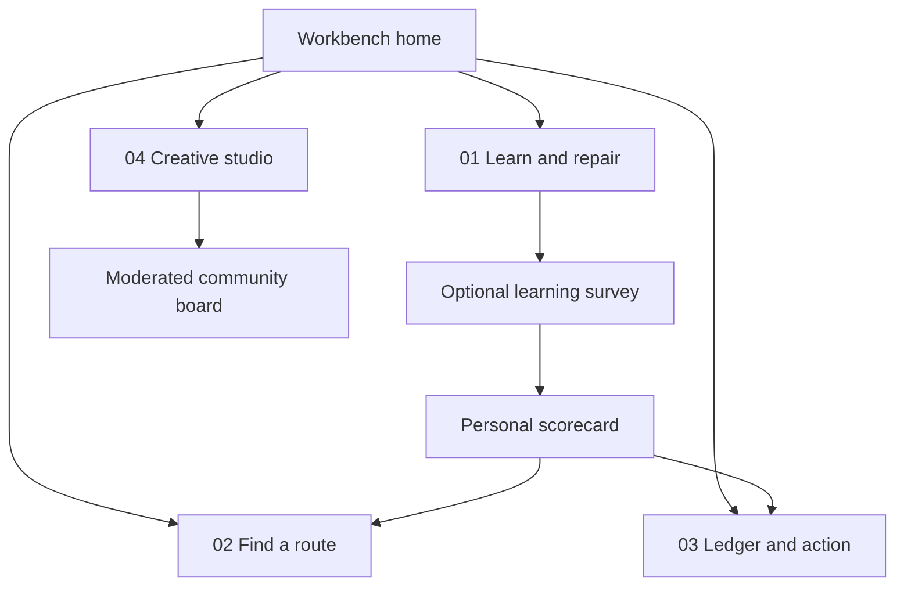

# Keep It Moving Philly draft conceptual design specification

**Status:** Draft for review, 28 October 2026. **Relationship:** extends the private Keep It Moving material workbench prototype. This is a product and interaction specification, not a claim that the described services are live.

## Information architecture



A separate `/cause` editorial page explains the problem, the local context, the limits of the evidence, and the site's relationship to partners. A source-linked `/articles/:slug` collection holds specific articles. Global navigation exposes these pages independently of the four cards. Suggested product name: **Keep It Moving Philly**; site identity can retain “Keep It Moving” in the hero and add “Philadelphia material commons” in metadata and explanatory copy.

## Four process cards as doors

| Card | Click destination | First-screen promise | Useful action | Later capability |
| --- | --- | --- | --- | --- |
| **01 Repair Commons** | `/learn` | “Could this item stay in use?” | Article on condition and repair options; open a 2-minute video in an accessible modal; begin or skip survey | Local clinic calendar and contributor tutorials |
| **02 Textile Network** | `/find` | “Where can it go next?” | Choose item condition and material; browse a verified Philadelphia list or open the City finder; ZIP/manual search | Permission-based nearby results and partner-maintained listings |
| **03 Material Ledger** | `/action` | “What can we learn and do?” | See the user's private scorecard and tailored checklist; inspect aggregate evidence only when publishable; voluntary pledge and partner donation links | Audited aggregate ledger and partner outcome receipts |
| **04 Creative Studio** | `/studio` | “What else could it become?” | Explore material design tokens, craft projects, makers, and curated videos; compose a share card | Opt-in community collage and project submissions |

The card itself is a real link. Hover/touch can reveal one sentence, but navigation does not depend on hover. Back navigation preserves survey progress locally. Each page has its own URL, title, headings, and meaningful fallback if animation or GPU effects fail.

## Page layouts and interactions

### `/cause` and `/articles/:slug`

- Lead with the local question and a sourced, dated fact; distinguish Philadelphia data from national estimates. Each numeric chart shows unit, geography, timeframe, denominator, source, and uncertainty.
- Use a “what can I do today?” rail to the finder, repair guide, and studio; an article can end with a voluntary survey invitation.
- Publication integration starts as editor-reviewed links or summaries with canonical links. Substack or other feeds require a source-specific permission and ingestion review; do not assume automatic cross-posting or full-text reuse.

### `/learn` survey as education and research

**Consent screen:** “Learn without sending answers” and a separate unchecked “Contribute anonymous category answers” choice. Explain exactly what leaves the device, retention, who sees aggregates, and how to withdraw before submission. Do not promise anonymity until infrastructure logs, free text, location, and aggregation have been audited.

**Proposed 12-question path, three sections:**

1. **The item:** type of item; condition; fiber known/unknown; number of times worn or used recently (range, optional).
2. **The options:** repair confidence; access to tools or a repairer; reason an item is leaving use; preferred next use; transport constraint.
3. **The action:** willingness to repair, gift, sell, donate, or recycle; confidence in a destination's acceptance rules; one next action; optional ZIP for a *separate* local search, never attached to survey storage.

Questions use multiple-choice or ranges and “not sure / skip.” No required free text, exact address, income, age, or personal ID. After every 2–3 questions, show one cited learning panel with a simple chart, comparison, illustration, or table. These panels are evidence, not a persuasive answer cue: present them after the relevant response and never alter a previously submitted answer. A text equivalent and “source / date / method” accompany every visualization. Store progress only in browser session state unless the visitor explicitly submits.

**Example educational panel:** “Repair, donate, recycle: what each route actually requires” as a decision table. Another panel can show a dated, sourced Philadelphia textile disposal figure; never mix it with an individual response as though the sample is representative. A public visitor-response chart is hidden until the sample is large enough and the methodology is shown.

### `/action` personal scorecard and checklist

Call the result a **Reuse Pathway Scorecard**. Show five dimensions (condition clarity, repair feasibility, reuse route, destination confidence, next-step readiness), each 0–4 with its own explanation. The profile is a planning aid, not a moral grade or an environmental impact estimate. No carbon or water “saved” number is inferred from answers. Offer “not enough information” where necessary.

Proposed deterministic rule: two category answers inform each dimension, scored 0, 1, or 2 for an explicit action opportunity, total 0–4. A skipped input makes that dimension “unknown,” not zero. Display the five dimensions side by side, plus a suggested route derived from item condition and verified acceptance rules. Route precedence is contextual: keep using or repair where safe and wanted; offer suitable reuse or donation; use a verified textile recycler for an unsuitable reusable item. Do not force a single total score across incompatible materials and circumstances.

Generate a **5–10 step plan** from the route and barriers, with checkboxes, time/effort labels, and alternatives. Example for a torn shirt: inspect fabric and care label; decide whether it is safe to mend; try a small stitch tutorial; ask a repair partner if needed; photograph before/after optionally; keep using or gift; if beyond repair, check a verified textile route; confirm the destination accepts the material. Provide print/download and local save; do not require a pledge or share.

**Pledges and donations:** a pledge is optional, editable, and private by default. The first release can show a cause-aligned partner's own donation link, clearly naming the recipient; the site does not collect funds or imply tax deductibility. An on-site donation flow needs an identified legal recipient, processor, receipts, refunds, accessibility, privacy, and a separate approval. If affiliate revenue exists, label it beside each relevant recommendation.

### `/find` local route finder

MVP: item condition filter + manually verified destinations with accepted items, exceptions, address, hours link, last verified date, source, and “confirm before visiting.” Offer the [Philadelphia Recycling & Donation Finder](https://www.phila.gov/recycling-donation-finder/) as the authoritative fallback. The City's guide says textiles are not accepted in curbside recycling. A Google Maps search result alone cannot establish what a site accepts. [City textile guide](https://www.phila.gov/2020-10-17-textilewaste/).

Later: a “Use my location” button asks browser permission at the moment of use; a ZIP/manual entry remains available. Use approximate location in memory for the search and discard it afterward. Google Maps URLs can open directions with a modest integration; a richer in-page Places search needs a project, billing, quotas, field masks, key restrictions, attribution, and acceptance verification. [Geolocation](https://developer.mozilla.org/en-US/docs/Web/API/Navigator/geolocation) · [Maps URLs](https://developers.google.com/maps/documentation/urls/get-started) · [Places Nearby Search](https://developers.google.com/maps/documentation/places/web-service/nearby-search).

### `/studio` material design system, video and community

Show the material system as a practical gallery: swatch families, texture and shader demonstrations, color/contrast tokens, motion settings, reusable components, downloadable creative prompts, and making techniques. Each sample states material provenance or “illustrative digital texture.” Video cards have title, maker, duration, skill level, materials, and source; the modal loads the YouTube iframe only after activation, pauses/removes it on close, traps focus, supports Escape, and exposes a link to watch on YouTube. Curate first; API search can follow if editorial capacity and quota justify it. [YouTube IFrame API](https://developers.google.com/youtube/iframe_api_reference).

**Share kit:** choose one of eight preset compositions (workwear, collage, botanical, minimal, bright civic, dark editorial, playful sticker, monochrome), then choose a badge/sticker, edit the text, see alt text and contrast checks, and export PNG plus editable caption. Use native Web Share when supported and copy/download fallbacks. Visitors select the destination themselves; no automatic LinkedIn, Substack, or social posting. A LinkedIn posting integration requires the user's OAuth authorization and applicable permissions. [Web Share API](https://developer.mozilla.org/en-US/docs/Web/API/Web_Share_API) · [LinkedIn access](https://learn.microsoft.com/en-us/linkedin/shared/authentication/getting-access).

**Community collage:** use a first-party submission form with photo rights affirmation, chosen attribution, optional outward link, moderation, and removal requests. Show “awaiting review” privately; publish only approved submissions. Hashtags `#KeepItMovingPhilly` and a project tag can invite discovery but are not a license to ingest or display third-party posts. A live hashtag feed needs platform-specific access, content rights, moderation, rate limits, and deletion handling; it is out of the first release.

## Data boundaries and minimal schemas

```text
SurveySubmission {
  schema_version, submitted_at_day, answers: {question_id: enum_or_range},
  consent_version
}
PublicAggregate {
  question_id, option_id, count, sample_size, time_window,
  method_version, source_note
}
Destination {
  id, name, address, accepted_materials[], exceptions[],
  source_url, last_verified_at, verified_by_role, status
}
CommunitySubmission {
  id, image_asset, caption, attribution_choice, rights_attested_at,
  moderation_state, removal_token_hash
}
```

No survey row contains exact location, free text, email, social handle, device fingerprint, or public user ID. Operational logs and service-provider retention still require a privacy review. Only publish aggregates above a proposed suppression floor of 20 responses per displayed group; do not show small geographic slices or combinations that can reveal people. A privacy and threat review must set the final threshold and retention policy. A personal scorecard remains client-side unless a separate, explicit save feature is designed.

## Content and visual system

- Preserve the textile workbench's warm dark surface, woven labels, pinned swatches, and tactile button while giving each destination a distinct material language. GPU effects are decorative, capability-gated, and replaceable with CSS.
- Use GSAP for optional transitions, never for the only path to content. Honour reduced motion; keyboard and touch have equivalent actions. Data visuals must include the data table or textual finding, source, date, unit, and sample size.
- A persistent “source and correction” pattern on fact cards and directory entries lets visitors contest errors. High-stakes or uncertain claims receive a clearer explanation rather than a more confident animation.

## Acceptance examples

- Clicking each of four cards changes to its intended URL; deep links, refresh, keyboard Enter, back/forward, and browser history work.
- Survey can be completed and scorecard generated with network blocked; opting out sends no survey answer request. Skips yield unknown dimensions.
- A destination whose verification expires is visibly flagged or removed; no unsupported claim that it accepts textiles appears.
- A video modal closes with Escape and returns focus; reduced motion, keyboard navigation, captions/link fallback, and narrow screens remain usable.
- Share export works without a social account, and public collage images never appear before moderation approval.
