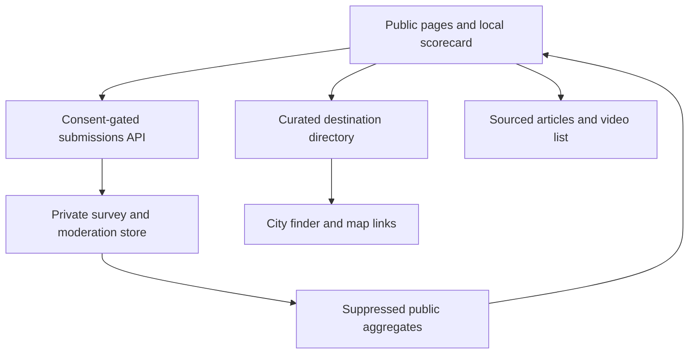

# Keep It Moving Philly operational build plan

**Status:** Draft implementation contract, 28 October 2026. **Repository evidence:** `MelodicBloom/philly-civic-ai`, default branch `main`, observed base commit `057fac7471cea494524cd7124d81b7595c8355fe`. Feature branch `feature/keep-it-moving-philly-concept-v0`. The existing `src/App.jsx` is an Agrarian Futures React/Vite interface; do not replace it as a side effect of this documentation branch. Existing Keep It Moving Sites source is a separate private prototype. Recheck all heads and worktree state before code work.

## Recommendation and boundary

Use the existing prototype to test the interaction concept, then give Keep It Moving a dedicated application or package boundary. Keep the Philly Civic AI repository as an umbrella for civic knowledge and this design record until the host and maintainers decide whether this should be a separate repository. Do not graft the textile site over the current Agrarian Futures entry point. A lightweight content-first application with server endpoints for submissions is enough for the first operational release; WebGPU, WebGL2, and GSAP remain progressive enhancements, not dependencies of the survey or locator.

**First pilot fixture:** one textile stream in Philadelphia, one small set of verified routes, one editorial owner, and a limited set of approved maker tutorials. Select the material stream and partners with them before setting real acceptance or impact claims. A pilot with no named content, directory, privacy, and moderation owners is a prototype, not an operational platform.

## Architecture

**Authority order:** source-linked editorial content and destination records own claims; City or partner confirmation owns acceptance rules; the scorecard's versioned rubric owns personal suggestions; survey submissions are observations, not population statistics. No client-side shader, social metric, or affiliate relationship can overrule these. The public ledger shows provenance and aggregation method, not raw responses.

## Stages and gates

| Stage | Deliverable | Dependencies | Pass evidence | Stop condition |
| --- | --- | --- | --- | --- |
| 0. Discovery | Two partner interviews, one item journey, editorial/moderation owners, destination list | Willing local participants | Notes approved for use; selected material stream and acceptance rules | No partner capacity or unclear data stewardship |
| 1. Navigation | Four card links and four real route shells, global cause/article routes | Content outline | Deep links, history, keyboard, mobile and reduced-motion checks | Any card becomes a dead end |
| 2. Learning | Source-linked article, curated video modal, survey and client-only scorecard | Fact review, video permissions or embed eligibility | Offline scorecard fixtures, skipped-answer behavior, accessibility review | Unsupported claims or score interpreted as measured impact |
| 3. Local action | Curated verified directory, checklist, City finder handoff | Destination confirmations and review cadence | Every listing has source, accepted items, exceptions, last check | Stale or ambiguous acceptance is presented as fact |
| 4. Community | Share kit, opt-in submission, moderation queue, removal | Moderator and rights policy | No unreviewed image public; removal exercised; 8 export styles | Moderation backlog exceeds agreed capacity |
| 5. Research | Consent-gated category submission and publishable aggregates | Privacy review, storage, retention and abuse design | Opt-out sends no answer; suppression tested; logs audited | Small-group disclosure or excess retention |
| 6. Integrations | Optional map search, publication feeds, OAuth posting, donation or affiliate relations | Real need, platform access, governance | Separate approvals and integration-specific tests | API changes, unclear beneficiary or cost |

Stages 1–3 form the smallest useful vertical slice. Stages 4–6 require explicit operating capacity, not just more UI.

## Implementation orders

1. **Repository and hosting decision.** Verify the Sites source checkout, the Philly Civic AI branch, current SHAs, deployment owner, and whether a dedicated repo should host this app. A docs-only PR can merge into Philly Civic AI independently of the app decision. Keep source code in one canonical repository; avoid copies that drift between Sites and GitHub.
2. **Routes and component contracts.** Convert the four `.swatch` controls in the current prototype into semantic links to `/learn`, `/find`, `/action`, and `/studio`, with independent page titles and a shared navigation shell. Preserve the design tokens and progressive GPU fallback. The details panel may become a preview on focus/hover but must not consume the click.
3. **Content schema and provenance.** Version articles, citations, figures, destination records, video metadata, and corrections. Give each fact a source URL, date, geography, unit, and review state. Build an editorial verification checklist, including stale-link and acceptance recheck jobs.
4. **Survey and rubric.** Specify question IDs, enums, skip behavior, routing rules, five scorecard dimensions, explanations, and action checklist mapping in versioned JSON or TypeScript fixtures. Implement client-only first. Include contrasting fixtures: intact garment, repairable tear, unsuitable donation, unknown material, no transport, and all-skipped.
5. **Submission API and storage.** After privacy review, accept only allowlisted answer categories and a consent version. Reject free text and precise location. Rate-limit and protect against abuse without introducing covert user tracking; document infrastructure log retention. Store raw rows privately for a bounded interval; publish only suppressed aggregates with sample size and method version. Test a data deletion/retraction path before launch.
6. **Finder.** Start with the City's official finder and a human-confirmed short list. Add optional location only after manual search works. If Google Places is introduced, restrict keys, bound spend and fields, comply with display/attribution requirements, and join search results to verified acceptance data rather than trusting category alone.
7. **Video, studio, share, and board.** Lazy-load embeds on click; keep transcripts or accessible alternatives where available. Build eight export presets and editable text with user-controlled share. Accept first-party photo submissions only with rights confirmation and a working moderation/removal flow.
8. **Pledges, donations, and publications.** Begin with editable local pledges and outbound, vetted partner URLs. Name the recipient, affiliate relationship if any, and limits of site responsibility. Evaluate direct payments and social OAuth separately; never ask for broad posting permissions to make a share card work.

## Quality, privacy, and human-capacity gates

| Invariant | Method and environment | Proposed gate | Receipt |
| --- | --- | --- | --- |
| Four doors work | Browser tests at desktop and 360px mobile, keyboard, refresh and history | 4/4 routes functional, no trap | Test log and screenshots |
| Survey choice is real | Network inspection with opt-out and opt-in fixtures | 0 answer submissions when opted out | Request trace |
| Scorecard is explainable | Deterministic fixture tests in CI | Every displayed dimension maps to a rubric version; skips stay unknown | Fixture JSON and test output |
| Directory is trustworthy | Human review of every pilot listing | 100% with accepted items, exceptions, source and last verified date | Listing audit CSV |
| Public aggregate is non-identifying | Unit test suppression, query review, log audit | No cell under proposed 20; final floor set by privacy review | Test output and review record |
| Community image rights | Submission, queue, publish, remove E2E | 0 unapproved public assets; removal works | Moderation audit |
| Accessible task completion | Keyboard/screen reader and reduced-motion review with pilot participants | No blocking issue for the core journey | Findings and fixes |
| Participant agency | Short interviews after pilot journey | Users can explain their route, source, and skip choices | De-identified notes with consent |
| Partner burden | Weekly check-in during pilot | Workload remains within a partner-agreed cap | Partner review notes |

Numbers here are proposed gates, not measured baselines. Before public launch, validate thresholds and retention with the accountable operators. Do not use engagement or pledge count as a proxy for material outcomes.

## Integration feasibility and cost controls

- **Maps:** freeform Maps URLs offer a low-dependency handoff. In-page Places Nearby Search needs Google Cloud setup, billing and field masks; location permission is optional and requested only after a click. [Maps URLs](https://developers.google.com/maps/documentation/urls/get-started) · [Places Nearby](https://developers.google.com/maps/documentation/places/web-service/nearby-search).
- **YouTube:** hand-curate a small list and embed on demand. Data API search adds quota and editorial review; an embed is not an endorsement or a license to reuse creator imagery. [IFrame API](https://developers.google.com/youtube/iframe_api_reference) · [API quota](https://developers.google.com/youtube/data/determine_quota_cost).
- **LinkedIn/social:** user-initiated Web Share or a copy/download kit first. Posting via LinkedIn API needs OAuth and `w_member_social`; organization posting has different permissions. Cross-post automation is a separate product and consent decision. [LinkedIn access](https://learn.microsoft.com/en-us/linkedin/shared/authentication/getting-access) · [Posts API](https://learn.microsoft.com/en-us/linkedin/marketing/integrations/community-management/shares/posts-api).
- **Substack/publications:** curate canonical links initially. Confirm each publication's feed and reuse rights before ingesting; avoid copying full articles by default.
- **Hashtags:** treat them as a way for participants to discover the cause. The board uses submitted, approved media; do not promise a complete cross-platform hashtag feed.
- **Affiliate and donations:** disclose paid links plainly beside recommendations. The first release links to a named recipient's own donation page, avoiding custody of funds and ambiguous receipts. [FTC endorsement guidance](https://www.ftc.gov/business-guidance/resources/disclosures-101-social-media-influencers).

## Failure, rollback, and governance

- If destination data is stale, hide the affected listing and send visitors to the City's finder. If the aggregate threshold or log boundary fails, disable submissions and public charts while preserving the client-only learning journey.
- If the gallery has no moderator, stop accepting uploads; keep the curated studio. If a platform API changes, keep copy/download, curated links, and manual search functional.
- Affected participants need a correction and removal channel; partners can veto inaccurate descriptions of their intake rules. Record editorial corrections publicly with date and reason, without exposing submitters.
- No public launch until named owners accept privacy notice, retention, moderation, data claims, destination verification, accessibility, and incident response. Deployments and GitHub merges are separate decisions.

## Definition of done for this planning branch

- The value alignment, design spec, and this build plan exist on the feature branch without modifying the Agrarian Futures application.
- Four card destinations, survey/scorecard, finder, studio, sharing, board, and integration gates have explicit scope and testable acceptance conditions.
- The branch head and three document URLs are verified. No claim is made that the planned backend or partner network exists.

**Next owner decisions:** confirm the name/tag, first material stream, two pilot partners, editorial/moderation owner, and app repository/hosting boundary. Then authorize a bounded Stage 1–3 implementation against a fresh checkout.
